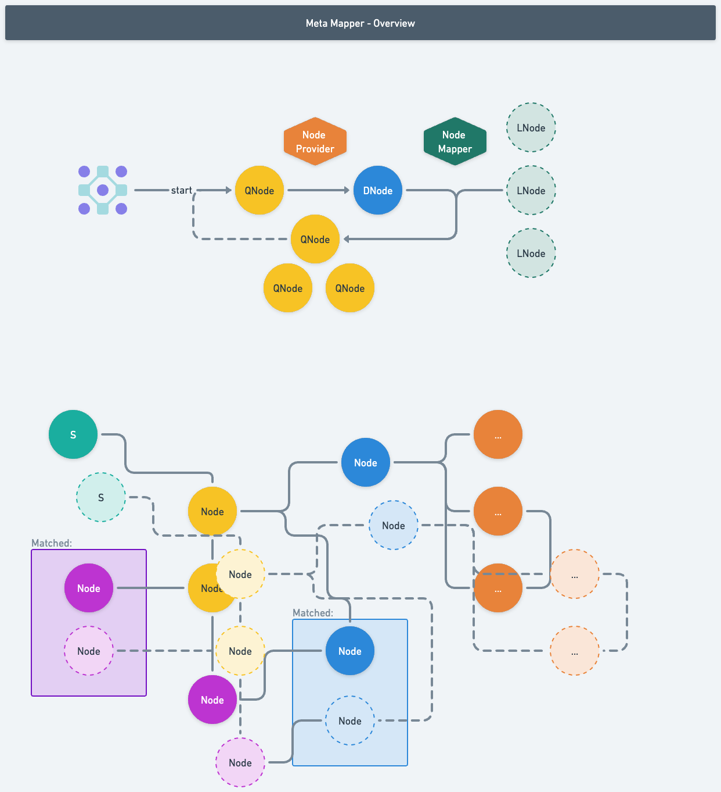
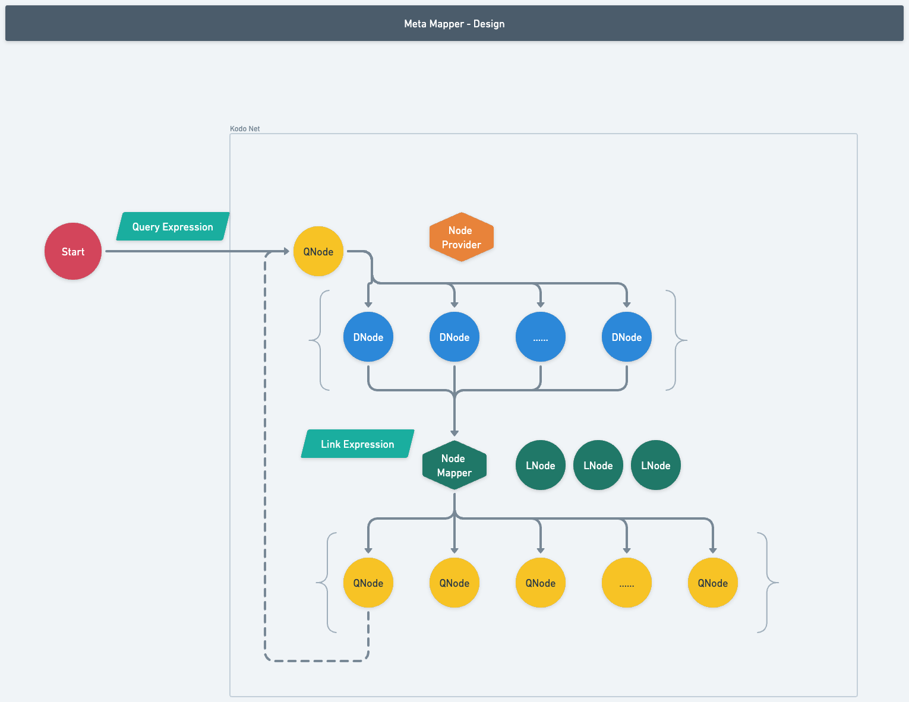

# kodo-core
It's bulky, but it's powerful.

## Install
npm install --save kodo-core

## Summary
`kodo-core` is used to describe & connect Heterogeneous data (source) together.
By doing so, kodo-core could be able to load & query data from one `kodo node` to another, in a predefined `kodo network`.

## Key Ability
* `Pre-Condition-A`: Link data model | structure together into a `network`, or a `map`.
  > Data model can be based on heterogeneous data source (i.e. Postgre, DynamoDB, Memory, API-JSON etc.).
  > This ability provided by `IDataProvider` as a plugin can be registered.
* `Pre-Condition-B`: Query from one point of the data model you defined above.
  > This ability provided by `INodeTranslator` as a plugin can be registered.
* `Kodo.explore()` can then auto. query based on the datasource & network defined in `Pre-Condition-A` & `Pre-Condition-B`.
* `Kodo.checkRules()` can be used for data validation among the query result - `DataNode(s)`.

## Init & Usages
We first need to prepare the `data provider` for kodo-core, here's a default inside momory provider embeded in `kodo-core`.
> Check the test cases please there's a few examples.
Then we need write `expression` to describe the data relationship & connect them together.
By doing the 2 preparations, we can then give a detailed data from any `kodo node` & start to query.
It then will select & load all the related data via your giving.

## Version Updates
* v0.0.4: Support query expression on `QueryNode<T>` when explore.
  > i.e. `expression: p => p.orderid === "o3" && p.id === "p3-2"`
* v0.1.1: Swtich compiler tools from `NodeJs` to `Bun`
* v0.1.2: Add `DynamoDB Data Provider`, note only support Query, Scan is not supported. Add option `limit` as well to avoid unintentional of massive query
* v0.1.3: Try `AI Coding`
* v0.1.4: Add KodoOption, `openspec`
* v0.1.5: Fix bug & simplify link-expression
* v0.1.6: Add object `{get $id(): string;}` to support custom id
* v0.1.7: Add `rule & notification`
* v0.1.8: `[break-change][interface]` fix multi-nodes w/ the same parent issue, change type of $fromQN from obj => arr
* v0.1.9: Add `$from`, `$to` onto `DataNode`, plan to use those 2 as formal linkage usage.

## Plan to Support Features
* `CEL` (Google - Common Expression Language)
* Customzied `Map Query` based on CEL
* Enhanced `Rule` | `Notification` via `CEL` | `Map Query`
* Support `JSON Object | Path` grammar in `QueryExpression`
* Support `JSON Object | Path` grammar in `CEL` | `Notification`

## Plan to Fix
* Customized `JSON.stringify()` to allow Node (DataNode | LinkNode | QueryNode) to go across network.

## Design
* Kodo-Overview:

* Kodo-Design:

